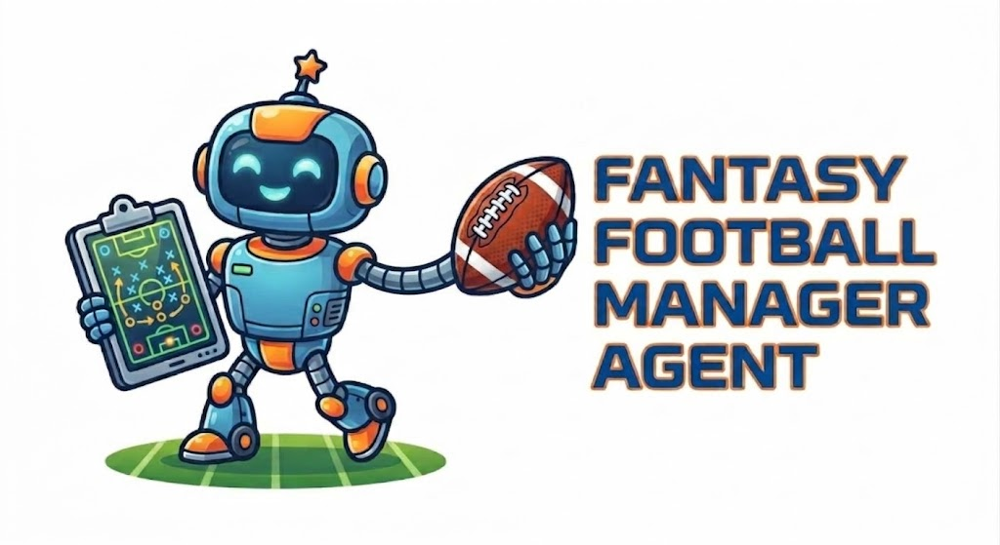
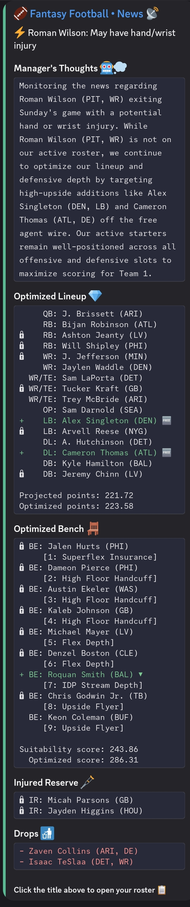
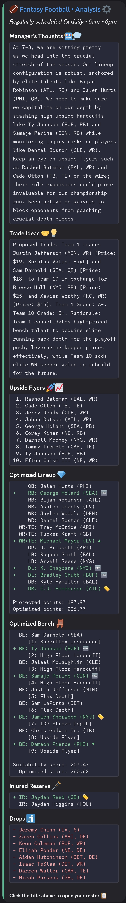

## Description

A serverless AI-enhanced fantasy football agent that delivers automated team management advice directly to [Discord](https://support.discord.com/hc/en-us/articles/228383668-Intro-to-Webhooks).

The agent analyzes your specific ESPN league data alongside real-time NFL depth charts, [Sleeper trend data](https://docs.sleeper.com/), [RotoWire breaking news](https://www.rotowire.com/rss/) and uses [Google Gemini](https://gemini.google.com/app) to evaluate and classify the news, roster updates, waiver wire targets and trade opportunities. It's designed to keep you notified and your roster tuned.

[Mixed-Integer Linear Programming](https://pypi.org/project/PuLP/) is leveraged to optimize your starting lineup by maximizing projected points. An optimal bench strategy is also dynamically computed based on your league size and roster configuration. Every available player on your roster and in free agency is scored to determine the ideal players for each bench slot. While AI doesn't *directly* compute your lineup changes, it affects player selection by classifying the news and feeding that information to the solver algorithm. Roster operations are then communicated via diff-style change suggestions shown in Discord.

* **Scheduled Analysis:** Runs 5x daily using Gemini Flash for deep roster evaluations.
* **Instant News Triggers:** Runs on-demand using Gemini Flash Lite when breaking NFL news is detected.
* **100% Free Tier:** Built to run automatically in the cloud within standard free-tier limits.

## Example Discord Alerts

<table>
  <tr>
    <td width="25%" valign="top">
      
    </td>
    <td width="25%" valign="top">
      
    </td>
  </tr>
</table>

## Workflow Summary 🔄

1.  **Polling ([Cloudflare Worker](https://www.cloudflare.com/products/workers/)):** A tiny Javascript sentinel polls an external RSS feed on a CRON schedule utilizing [Cloudflare KV](https://www.cloudflare.com/products/kv/) to deduplicate previously seen news items.
2.  **Dispatch ([GitHub Dispatch](https://docs.github.com/en/actions/reference/workflows-and-actions/events-that-trigger-workflows#repository_dispatch)):** If new news is found (or a specific time window matches) the Worker dispatches a `repository_dispatch` event to [GitHub Actions](https://github.com/features/actions).
3.  **Analysis (GitHub Actions/Python):** The GitHub Actions environment spins up, installs dependencies and runs the main Python [manager.py](manager.py) script. This script handles the multi-source data aggregation, executes LLM inference (with robust retry logic) and posts the structured results to Discord.

## Setup ⚙️

This assumes you have a Discord channel ready to receive your alerts and know how to setup a Webhook.
You can clone this repository as a private repository. Then you need to configure your Actions secrets for the repository. Set these secrets for an environment named `Production`.

### GitHub Action Secrets 🔐

1. `GEMINI_API_KEY` - Set this up with Google. Do not enter any billing information to use the free tier.
2. `GEMINI_MODEL` - Not strictly a secret, but these are all setup the same way. Currently I use "gemini-3.6-flash".
3. `GEMINI_FALLBACK_MODEL` - I currently use "gemini-3.5-flash-lite".
4. `ESPN_LEAGUE_ID` - Your league's ID.
5. `ESPN_TEAM_ID` - Your team's ID.
6. `ESPN_YEAR` - Season year.
7. `ESPN_S2` - Needed for private ESPN leagues. Must fish out of a logged in browser using developer console.
8. `ESPN_SWID` - Credentials fished out of logged in browser using developer console.
9. `WEBHOOK_URL` - Webhook URL created in Discord.

Test this by using the `Run workflow` option under the manager action.
Now you need to setup the 2 Cloudflare workers. They expect secrets configured in Cloudflare as well.

### Cloudflare Worker Secrets 🔐

1. `GITHUB_TOKEN` - Follow Gemini instructions for how to setup a token for use with the `repository_dispatch` event in GitHub Actions.
2. `GITHUB_OWNER` - The repository owner's login.
3. `GITHUB_REPO` - The repository's name (e.g. `fantasy-manager`).

#### manager-trigger

This runs every 10 minutes via CRON scanning for new news or checking against its (currently) hardcoded schedule.

Run `npx wrangler deploy` in [cloudflare/manager-trigger](cloudflare/manager-trigger) to deploy.

#### injury-trigger

This runs a few times per week via CRON to update the injury data.

Run `npx wrangler deploy` in [cloudflare/injury-trigger](cloudflare/injury-trigger) to deploy.

That should be it! Your personal fantasy football manager agent should be up and running in the cloud.

## Disclaimer ⚠️

Use at your own risk. I wrote this mainly as a proof-of-concept just before the beginning of this season and only had a few active weeks of the season to test. Pull requests are always welcome.
